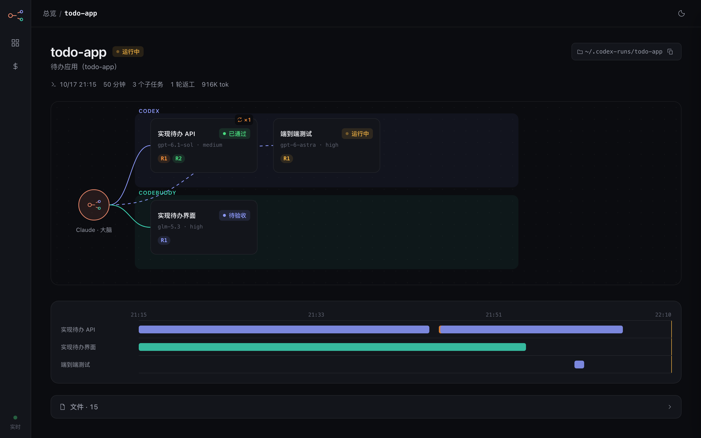
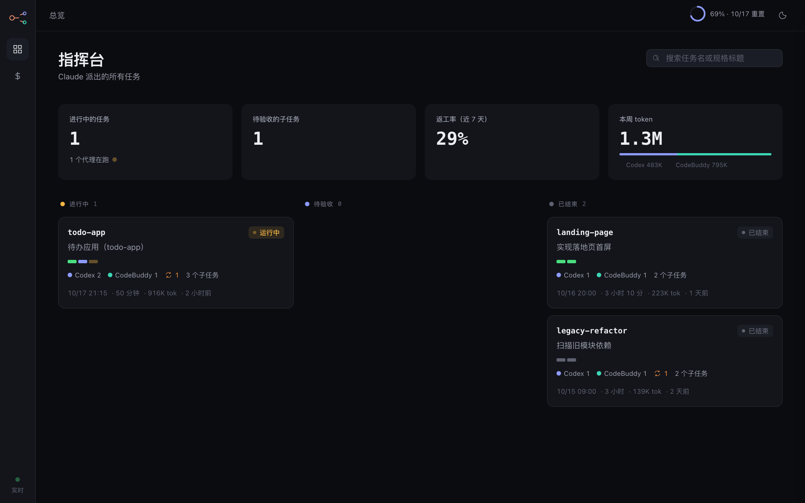
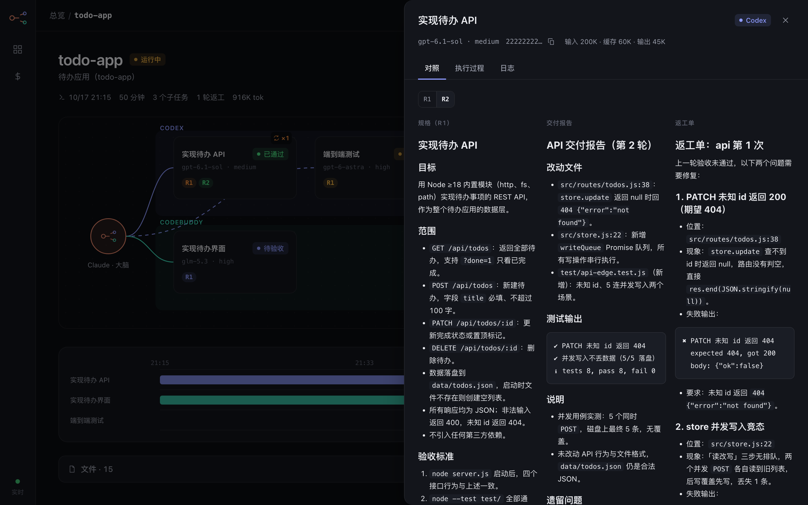

# claude-leading-agents

一个 [Claude Code](https://claude.com/claude-code) Skill：让 **Claude 当大脑，Codex CLI 和 CodeBuddy CLI 当双手**。

Claude 负责判断该不该派活、拆任务、写规格和验收标准、亲自验收和返工；写代码、读大代码库、反复调试这些「重活」交给 Codex（难活）或 CodeBuddy（量大、边界清楚的活）。最后出一张 token 账单，看清钱花在哪。

> A Claude Code skill where Claude plans, writes specs, and verifies, while OpenAI Codex CLI and CodeBuddy CLI do the implementation. Includes helpers for headless CodeBuddy runs, one-shot acceptance checks, Codex quota, and a per-task token ledger. Docs are in Chinese.

## 为什么

- Claude 的 token 最贵，而且每多一轮工具调用，就要把整段上下文再读一遍。把重轮次的活交出去，Claude 自己少走轮次，才省钱。
- 代理说「已完成」「测试通过」不作数。验收一律以 Claude 亲自看到的 diff 和测试结果为准，不合格就带着具体问题接回原会话返工。
- 派活有固定开销。Skill 里写了派活门槛：小而集中的活 Claude 直接做，不硬派。

## 分工：谁干什么

| 档位 | 典型任务 | 派给 |
|---|---|---|
| T0 调研 | 只读：找调用点、定位原因 | CodeBuddy（只读模式） |
| T1 简单 | 单文件小改、补测试、明确报错的小 bug | CodeBuddy |
| T2·清 | 接口和行为已写死、有测试可跑 | CodeBuddy |
| T2·绕 | 状态多、边界多、要读懂现有设计 | Codex |
| T3 困难 | 跨模块/架构、并发/性能/安全、原因不明 | Codex |
| 评审 | 第二意见代码评审 | Codex（可再加 CodeBuddy 做第三意见） |

- Codex 额度紧张（周额度 >70%）时，Skill 会把能下沉的 T2 都改派 CodeBuddy。
- CodeBuddy 返工 2 轮还不过，就转给 Codex。
- 互不相干的子任务会在不同目录里让两个代理并行跑。

## 内容

```
skills/claude-leading-agents/
├── SKILL.md    流程：派活门槛 → 配比表 → 写规格 → 并行派活 → 验收 → 返工 → 汇报 + 账单
├── cb.sh       无头运行 CodeBuddy，用权限模式 + 工具白名单/黑名单约束（CodeBuddy 没有系统沙箱）
├── check.sh    一条命令看全验收信息：代理报告结尾、改动文件、测试结果
├── quota.py    读本地 Codex 会话日志，显示 ChatGPT 套餐额度用了多少
└── tokens.py   按工作目录汇总 Codex / CodeBuddy 会话的 token 用量
```

脚本只读 `~/.codex/sessions` 和 `~/.codebuddy/projects` 里的会话日志，不碰任何登录凭证。

## 安装

前置：
- [Claude Code](https://claude.com/claude-code)
- [Codex CLI](https://github.com/openai/codex)，已登录（`codex login`）
- [CodeBuddy CLI](https://www.npmjs.com/package/@tencent-ai/codebuddy-code)（腾讯，国产模型），已登录：
  ```bash
  npm install -g @tencent-ai/codebuddy-code
  codebuddy   # 首次运行按提示登录
  ```
  不装也能用：配比表里派给 CodeBuddy 的活改派 Codex 即可
- Python 3.8+、bash

```bash
git clone https://github.com/DeanHilarious/claude-leading-agents.git
mkdir -p ~/.claude/skills && cp -r claude-leading-agents/skills/claude-leading-agents ~/.claude/skills/
```

装好后在 Claude Code 里说「让 Codex 实现 xxx」「带着 codex 干活」或输入 `/claude-leading-agents <任务>` 即可触发。

## 使用前注意

- **模型名要换成你自己的。** `SKILL.md` 配比表里的模型名（`gpt-6-astra`、`gpt-6.1-sol`、`glm-5.3`、`deepseek-v4.1-flash` 等）是写作时的示例。Codex 可用模型看 `~/.codex/models_cache.json`，CodeBuddy 看 `codebuddy --help`。
- **要关 Claude Code 的沙箱跑这些命令。** Codex / CodeBuddy 要联网、要写自己的配置目录，Skill 里已要求对这些命令使用 `dangerouslyDisableSandbox`，Claude Code 会逐条请你批准。
- **CodeBuddy 没有系统沙箱。** `cb.sh` 只靠权限模式和工具白名单约束它：禁止联网、装依赖、git 提交/回滚、`rm -rf` 等。不要给它加 `-y`，也不要在含敏感数据的目录里派它干活。
- CodeBuddy 的积分余额命令行查不到，账单以 `tokens.py` 统计的 token 为准。
- 运行记录（规格、日志、结果、返工单）默认放在 `~/.codex-runs/<任务名>/`。

## 指挥台：把协作过程画出来

`dashboard/` 是一个零依赖的本地网站，读取 `~/.codex-runs` 和代理的会话日志，显示 Claude 派了哪些活、谁在做、返工几轮、花了多少 token。只读、只监听 127.0.0.1。



| 总览 | 子任务抽屉 |
|---|---|
|  |  |

```bash
node dashboard/server.js            # 你自己的任务 → http://127.0.0.1:4177
node dashboard/server.js --demo     # 演示数据
```

详见 [dashboard/README.md](dashboard/README.md)，界面设计见 [dashboard/DESIGN.md](dashboard/DESIGN.md)。

指挥台也可以部署成「本地上报 → 服务器展示」的远程模式：技能照旧在本机跑，上报器把任务数据脱敏后增量同步到公网服务器，服务器上的看板加密码登录，体验与本地版一致（见 [dashboard/README.md 的「远程模式」](dashboard/README.md#远程模式)）。

部署模板（systemd + nginx + 环境变量示例）在 [dashboard/deploy/](dashboard/deploy/)，逐步指南见 [dashboard/deploy/DEPLOY.md](dashboard/deploy/DEPLOY.md)。

## 许可

[MIT](LICENSE)
